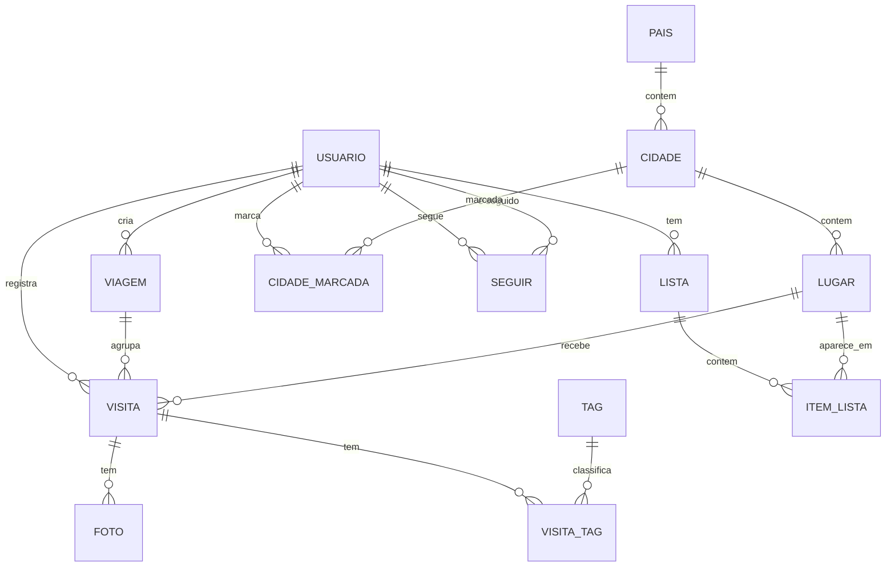

# 8. Modelo de dados

Modelo conceitual: entidades e campos principais, sem código. Toda tabela tem `id`, `criado_em` e `atualizado_em` (omitidos abaixo).

_Figura 1. Entidades principais e cardinalidades (1 e N indicam “um” e “muitos” em cada ponta)._

| Entidade | Campos principais | Observações |
| --- | --- | --- |
| Usuário | nome, username, e-mail, cidade_residencia_id, confirmou_18_em, visibilidade_padrao, mostrar_sequencia, nivel_confianca, lugares_confirmados | Cidade de residência é privada; nível de confiança é derivado (D6) |
| Consentimento | usuario_id, finalidade, versao_politica, aceito, data | Um registro por finalidade e versão |
| País | nome, codigo_iso, geometria | Polígono |
| Cidade | nome, estado_regiao, pais_id, geometria, fonte | IBGE no Brasil; Overture no exterior |
| Lugar | nome, verificado, verificado_por, origem_criacao, categoria_overture, categoria_lugora, categoria_corrigida, ponto, endereco, cidade_id, fontes, confianca, id_externo, ids_externos, status, mesclado_em_id, criado_por | status: ativo, pendente, fechado ou mesclado |
| CategoriaMapa | categoria_overture, categoria_lugora, grupo, visitavel, sensivel | Mantida pelo projeto (D3 e D5) |
| Sinalizacao | lugar_id, usuario_id, tipo, categoria_sugerida, status, criado_em | fechou, mudou, categoria errada, duplicado (D2) |
| Visita | usuario_id, lugar_id, data_visita, nota, comentario, eh_morador, viagem_id, visibilidade, publicar_em, verificada, origem_verificacao, status | O coração do produto |
| Foto | visita_id, url, url_miniatura, largura, altura, ordem, texto_alternativo, mostrar_na_galeria | Sem metadados; consentimento da galeria por foto |
| Tag e VisitaTag | nome, tipo, ativa · visita_id, tag_id | Lista fixa; até 3 por visita |
| CidadeMarcada | usuario_id, cidade_id, ano | “Já estive”, sem lugar |
| Viagem | usuario_id, titulo, data_inicio, data_fim, status | Encerrar libera a publicação |
| ViagemParticipante | viagem_id, usuario_id, status | Fase 2 |
| Lista e ItemLista | usuario_id, titulo, tipo, visibilidade, slug_publico · lista_id, lugar_id, link_origem, nota_pessoal | tipo: quero_ir ou curadoria |
| Seguir | seguidor_id, seguido_id, status | status: ativo ou pendente |
| Convite | codigo, convidante_id, convidado_id, aceito_em | Mede o K |
| Denúncia | autor_id, tipo_alvo, alvo_id, motivo, status | Moderação |
| Evento | usuario_id, nome_evento, propriedades, momento | Base das métricas |
| ImportacaoOverture | release, executada_em, adicionados, removidos, alterados, reconciliados, sinalizados | Uma linha por atualização mensal (seção 10) |
| Parâmetro | chave, valor, descricao | Limiares configuráveis |

### Quatro regras de modelagem

- **`eh_morador` é uma fotografia do momento.** Gravado na visita, não calculado depois: a pessoa pode mudar de cidade.
- **`publicar_em` controla o que os outros veem.** O registro existe desde o início; a visibilidade é uma regra de consulta.
- **Indicadores são derivados.** Índice morador × visitante, perfil, faixas do mapa e sequência saem de views ou tabelas agregadas atualizadas periodicamente, nunca editadas à mão.
- **Agregados herdam a visibilidade.** Toda view ou tabela agregada aplica as regras da seção 9.3, e toda view exposta pela API respeita o RLS (seção 9.4).

---
Parte do documento de visão do Lugora (v0.5.1). Índice: [README](README.md).
